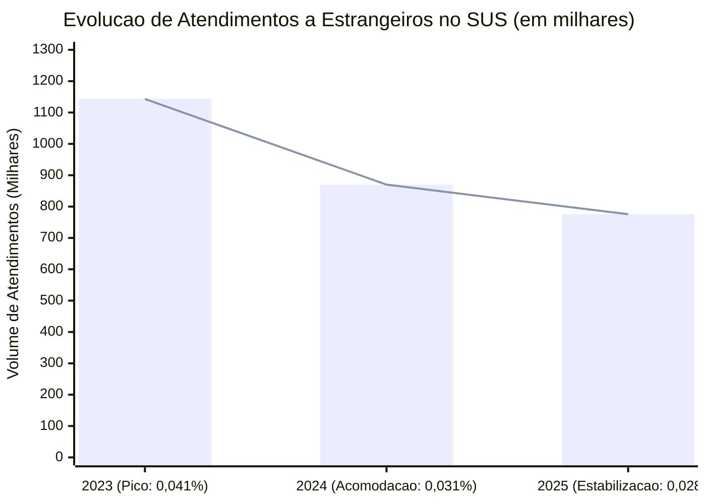
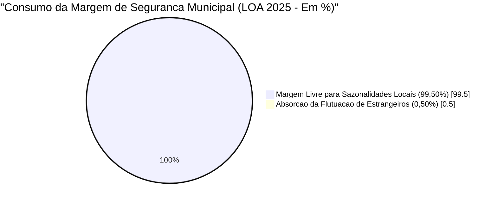

#  Impacto Orçamentário e Estatístico do Atendimento a Estrangeiros no SUS (2023–2025)


##  Resumo Executivo (TL;DR)
Este projeto analisa o impacto real do atendimento a cidadãos estrangeiros (residentes e não residentes) no **Sistema Único de Saúde (SUS)** sob a ótica da **Ciência de Dados**, **Contabilidade de Custos** e **Gestão Orçamentária Pública**. 

Através do cruzamento da produção ambulatorial e hospitalar nacional (~2,8 mil milhões de procedimentos/ano) com os registos de atendimento a estrangeiros entre 2023 e 2025, demonstra-se matematicamente que essa procura representa **entre 0,028% e 0,041%** do volume total do sistema — configurando uma **variação estatística residual** integralmente absorvida pela margem de segurança das Leis Orçamentárias Anuais (LOA), sem necessidade de dotações extraordinárias.

---

##  Principais Indicadores e Descobertas

| Métrica / Indicador | Valor Consolidado | Fonte / Referência |
| :--- | :--- | :--- |
| **Produção Anual Total do SUS** | ~2,8 mil milhões de procedimentos | DATASUS (SIA/SIH) |
| **Pico de Atendimentos a Estrangeiros (2023)** | 1.143.223 atendimentos | Ministério da Saúde |
| **Volume Estimado em 2024** | ~870.000 atendimentos | Projeção de Acomodação |
| **Volume Oficial em 2025** | 775.619 atendimentos | Ministério da Saúde |
| **Variação Acumulada (2023–2025)** | **-32,15%** (Retração / Acomodação) | Cálculo de Série Temporal |
| **Representatividade no Volume Nacional** | **0,0277% a 0,0408%** | Cálculo Proporcional |

---

##  Evolução Temporal (2023–2025)

A curva histórica refuta a hipótese de crescimento exponencial contínuo, demonstrando um comportamento de **patamares flutuantes** guiados por choques migratórios pontuais (2023) seguidos de estabilização e acomodação (2024–2025):



---

##  Fundamentação Económica e Contábil

A sustentabilidade financeira do princípio da **Universalidade** (Art. 196 da CF/88) frente a pacientes internacionais apoia-se em três pilares teóricos e contabilísticos:

1. **Alavancagem Operacional e Custos Fixos (Paul Samuelson - *Bens Públicos*):**
   Hospitais, UPAs e UBS operam sob custos fixos de prontidão (folha salarial, infraestrutura instalada, depreciação). O custo marginal de absorver uma oscilação de procura inferior a `0,05%` dilui-se na capacidade instalada já custeada.
2. **Teoria dos Custos de Transação (Ronald Coase):**
   Implementar um sistema nacional de auditoria, triagem imigratória na porta de entrada e cobrança internacional para reaver frações inferiores a `0,01%` do orçamento geraria um custo administrativo e burocrático superior ao próprio desembolso médico.
3. **Não-Afetação de Receitas e Financiamento Indireto (Richard Musgrave):**
   Imigrantes residentes e turistas financiam o "Caixa Único" do Tesouro imediatamente via tributação indireta sobre o consumo (ICMS, ISS, PIS/COFINS), cumprindo o ciclo fiscal que destina o piso constitucional à saúde.

---

##  Estudo de Caso Microeconómico: Juiz de Fora (MG) - LOA 2025

Para testar a hipótese no nível municipal, auditou-se o comportamento do Fundo Municipal de Saúde de Juiz de Fora frente à **Margem de Segurança Operacional** (estimada em 2% do orçamento para absorver sazonalidades epidemiológicas e flutuações):

* **Orçamento Total da Saúde (LOA 2025):** R$ 1.282.684.148,00
* **População Usuária Estimada:** ~340.000 habitantes (Custo médio per capita: R$ 3.772,60/ano)
* **Provisão da Margem de Segurança (2,00%):** R$ 25.653.682,96
* **Impacto de Flutuação Residual (<0,01%):** R$ 128.268,41 anuais (consome apenas **0,50%** da margem de segurança).



---

##  Estrutura do Repositório

```text
analise-orcamentaria-estrangeiros-sus/
├── README.md                                        # Documentação executiva e gráficos nativos
├── requirements.txt                                 # Dependências do ambiente Python
├── data/
│   └── dados_consolidados_sus_2023_2025.csv         # Série histórica e parâmetros da LOA 2025
├── notebooks/
│   └── analise_orcamentaria_estrangeiros_sus.ipynb  # Modelagem estatística e simulação contábil
└── sql/
    └── 03_extracao_agregacao_datasus.sql            # Queries de extração SIA/SUS e auditoria LOA
```

---

##  Como Reproduzir a Extração Oficial no DATASUS
1. Aceda ao portal **TabNet / DATASUS** (`SIA/SUS` - Produção Ambulatorial ou `SIH/SUS` - Produção Hospitalar).
2. Filtre os ficheiros de microdados pelas variáveis de nacionalidade (`PA_NAC <> '010'` para pacientes com código diferente de brasileiro) e caráter de atendimento (`PA_CATEND = '02'` para Urgência/Emergência vs. Atenção Primária).
3. Execute o script `sql/03_extracao_agregacao_datasus.sql` ou o notebook `notebooks/analise_orcamentaria_estrangeiros_sus.ipynb` para reproduzir as agregações.
